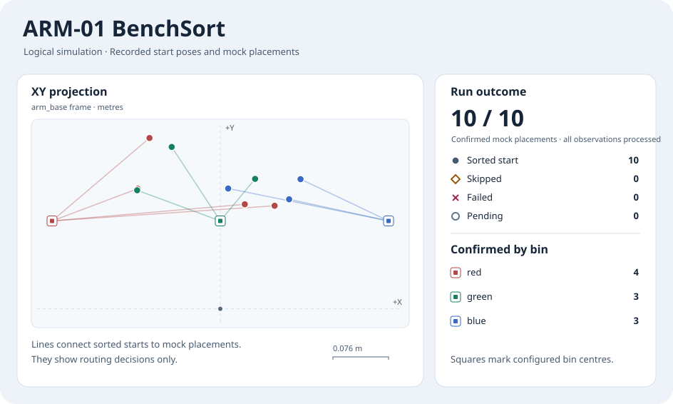
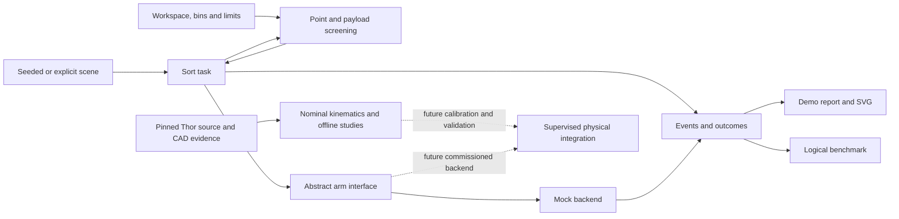

# RAFTEL

RAFTEL develops affordable, modular, repairable robots and reproducible embodied-AI experiments for household manipulation.

## Why RAFTEL exists

A useful robot has to locate objects, choose grasps, move within limits and verify what happened. Housing these experiments in a documented bench platform gives students and independent researchers a way to reproduce each result and investigate where the system fails.

## Current project · ARM-01 BenchSort

ARM-01 is a stationary, removable bench arm designed to identify and sort ten lightweight objects from variable positions into three bins. The design calls for six independent arm axes and a motorized parallel gripper. The Thor-first CAD study allows up to eight actuators, with seven arm motors including the coupled shoulder and one gripper motor. Reach, payload and cost remain [design targets](arm-01/docs/requirements.md).



This top-down view comes from the seed-42 mock run. It shows logical routing from pickup points to configured destinations. The lines denote assignments in the report.

## Current capabilities

| Evidence | Available today | Open gates |
| --- | --- | --- |
| Logical simulation | Seeded or supplied scenes, category routing, workspace and payload screening, mock grasp retries, recorded outcomes, JSON/JSONL/SVG export and layout benchmarks | Camera input, geometric grasp selection and observed physical outcomes |
| Nominal kinematics | Thor frame transforms, FK, Jacobian, bounded local IK and timed quintic joint paths under declared study constraints | Calibrated frames and limits, a conservative moving-body collision model and full native articulation checks |
| Conditional engineering studies | Provenance-linked CAD inventories, load and transmission models, saved-pose box screening, print drafts and a compatible FreeCAD assembly study | Original Art1 feature history, wrist/jaw closure, actuator capacity, fit and fabrication release |
| Learning experiment | A classifier fitted to synthetic planner decisions, evaluated on held-out layouts against deterministic baselines | Image perception, learning a manipulation policy, physics simulation and sim-to-real evaluation |
| Physical ARM-01 | Proposed workstation, design requirements and commissioning procedures | Reviewed hardware, independently measured motion and supervised physical sorting |

See the [engineering evidence index](arm-01/docs/desktop-evidence-index.md) for study artifacts and exact limits.

## Quick start

Use Python 3.11–3.14. Run these commands from the cloned repository on macOS or Linux.

```sh
python3 -m venv .venv
.venv/bin/python -m pip install ./arm-01
.venv/bin/raftel-sort --seed 42 --report benchsort.json --svg benchsort.svg
```

Use these commands in Windows PowerShell.

```powershell
py -3 -m venv .venv
.\.venv\Scripts\python.exe -m pip install .\arm-01
.\.venv\Scripts\raftel-sort.exe --seed 42 --report benchsort.json --svg benchsort.svg
```

Open `benchsort.svg` in a browser. The default demonstration should report ten sorted objects. The [BenchSort guide](arm-01/README.md) covers custom scenes, a deliberate failure, and the multi-layout benchmark.

Installing from source needs access to the pinned build backend. The installed demo runs offline using Python's standard library. No robot, camera, ROS or GPU is required.

## System architecture



The sorter uses `arm_base` coordinates in metres. Thor studies use nominal source frames. A measured transform between those frames remains open. Physical integration requires calibrated limits, feedback, fault handling and an independent motor-energy stop. See the [software architecture](arm-01/docs/architecture.md) and [commissioning gates](arm-01/docs/safety.md).

## Robotics and machine learning

The mock sorter isolates task logic and recovery from hardware. The offline learner studies whether a small model can imitate the planner's logical screen/defer decision and counts false accepts on held-out scenes. It has no control authority. Future experiments need calibrated camera observations and uncertainty, versioned demonstrations, and an environment with contact and actuator dynamics. A learned proposal must pass deterministic limits and path checks before any future physical execution. [Learning research track](arm-01/docs/learning-research.md)

## Research roadmap

The next software milestone is to measure nominal kinematic coverage against a declared set of BenchSort targets and expose local solver failures. Mechanical and electrical acceptance proceeds through a separate set of owner-reviewed gates. The [roadmap](docs/roadmap.md) tracks reproducible simulation, validated kinematics, motion planning, perception, learning and physical ARM-01 with acceptance evidence for each.

## Contributing

Good starting points include reproducing the demo on another host, adding a numerical regression or prerecorded calibration fixture, and checking a Thor study against its pinned inputs. Use the [contributor guide](CONTRIBUTING.md) for setup, checks and how to report findings. The [current handoff](nextSteps.md) tracks active work and decisions.

## Documentation

See the [engineering documentation index](docs/README.md) for hardware, architecture, research decisions, simulations and verification.

## License and attribution

RAFTEL's distribution license is undecided. The repository is publicly visible and has no project-wide reuse grant. Thor and other upstream sources retain their own terms. See the [licensing review and owner checklist](docs/licensing.md) and [upstream notice inventory](arm-01/docs/desktop-third-party-notices.md).
