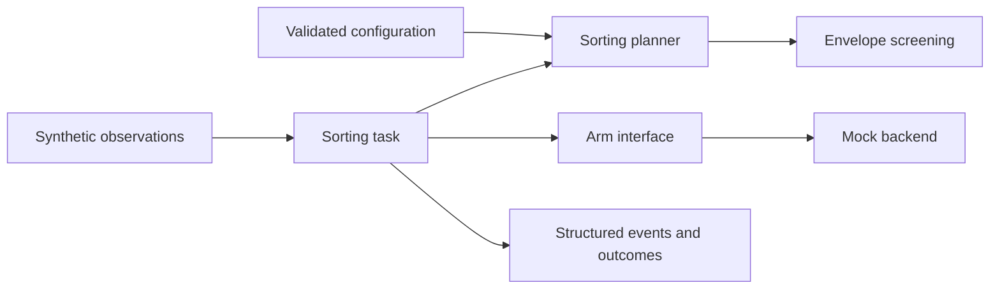

# ARM-01 software architecture

The first implementation is a lightweight Python task prototype. It accepts synthetic object poses, plans abstract pick/place steps, and commands a mock arm. Business rules remain independent of servo models and future perception/middleware integrations.

## Implemented responsibility boundaries

| Area | Location | Responsibility |
| --- | --- | --- |
| Models | `src/raftel_arm01/models.py` | Small typed object, bin and position values using explicit SI units |
| Configuration | `src/raftel_arm01/config.py`, `defaults.json` | Load and validate structured scenario/bin settings |
| Safety screening | `src/raftel_arm01/safety/envelope.py` | Validate positions and the mock operating envelope; no physical safety certification |
| Hardware interface | `src/raftel_arm01/control/interface.py` | Backend contract for abstract arm operations and outcome reporting |
| Mock control | `src/raftel_arm01/control/mock.py` | Deterministic logical motion/grasp/place behavior and injected failures |
| Synthetic observations | `src/raftel_arm01/perception/synthetic.py` | Seeded object positions/categories; no camera or image interpretation |
| Planning | `src/raftel_arm01/planning/sorting.py` | Category/bin routing, reachable-target screening and abstract waypoints |
| Thor drive convention | `src/raftel_arm01/kinematics/thor_drive.py` | Pure six-coordinate/seven-channel algebra; no spatial FK/IK or hardware commands |
| Task execution | `src/raftel_arm01/tasks/sorter.py` | Sorting progression, bounded handling of failures and recorded outcomes |
| CLI and evaluation | `src/raftel_arm01/cli.py` | Scenario setup, structured events and run summary |

The exact tested behavior and entry-point options are established by code, tests, CLI help, and [nextSteps.md](../../nextSteps.md). Implementation and validation may evolve together; do not infer functionality from a planned layer name.

## Data flow

Object observations supply pickup positions; configured bins supply destination positions. A real observer must later transform calibrated camera observations into the same robot-relative frame and expose uncertainty. Selection and sorting behavior should not need a camera-specific or actuator-specific rewrite.

## Frames and units

Use metres, kilograms, radians where angular modeling is introduced, and newton-metres for torque. Mock positions are expressed in the `arm_base` frame; the initial configuration loader accepts that frame only. Before adding a measured model, define `world`/workstation, `arm_base`, joint, tool-center-point, camera and bin frames with explicit transform directions and timestamp conventions. A future mobile frame chain should connect `map`/`odom`/`base_link` to the removable `arm_base`; do not couple task routing to a fixed world origin.

## Validation boundaries

| Evidence class | Meaning | Initial milestone |
| --- | --- | --- |
| Logical task simulation | Software decisions and abstract backend outcomes under a supplied scenario | Implemented scope; tests must establish behavior |
| Analytical calculations | Equations evaluated using explicit assumed or measured inputs | Preliminary load/floor-reach estimates only |
| Kinematic simulation | Joint-constrained forward/inverse transforms and modeled geometric feasibility | Future milestone |
| Physics simulation | Inertia, contact, friction, actuator/dynamics and sensor models | Future milestone |
| Physical operation | Calibrated hardware and independently observed real outcomes | Future milestone |

A point within a spherical envelope is not necessarily reachable at a desired orientation. Safe waypoints cannot be established without full robot/link geometry and obstacle checks. The mock backend therefore must never be substituted directly for a hardware driver with the expectation that its paths are safe.

## Integration sequence

1. Study Thor first as the existing editable CAD baseline under Liam's allowance of up to eight actuators. Preserve six independent arm axes plus a gripper; map its seven arm motors, including the coupled shoulder drive, separately from the six joint coordinates. The initial seven-total-actuator target is superseded. Extract and validate the actual source geometry, license/provenance, transforms, joint limits and collision geometry before releasing a revisioned robot description or approving physical changes.
2. Add a tested kinematics implementation, joint/path validation and trajectory representation; preserve logical sorting tests.
3. Add camera capture/calibration and simple object detection using NumPy/OpenCV when needed. Validate pose error and transform directions against known measurements.
4. On an independently validated hardware platform, add an explicitly armed driver with calibration, feedback freshness, velocity/current constraints, fault latching and independent motor-stop protection.
5. Evaluate ROS 2 Jazzy and MoveIt 2 for integration after the robot model is stable. Prefer a Linux/Ubuntu integration environment; keep the core mock package portable. Add LeRobot separately for recording, teleoperation or policy experiments when appropriate.
6. Introduce a physics environment only with documented model assumptions and comparison against physical measurements.

No optional integration is claimed installed or functioning by this architecture. Add dependencies only when their feature, version compatibility, license and tests are concrete.
