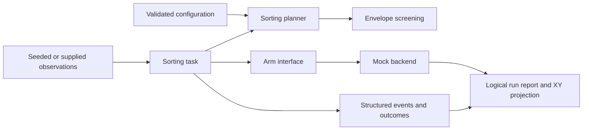

# ARM-01 software architecture

The first implementation is a lightweight Python task prototype. It accepts synthetic object poses, plans abstract pick/place steps, and commands a mock arm. Business rules remain independent of servo models and future perception/middleware integrations.

## Implemented responsibility boundaries

| Area | Location | Responsibility |
| --- | --- | --- |
| Models | `src/raftel_arm01/models.py` | Small typed object, bin and position values using explicit SI units |
| Configuration and scenes | `src/raftel_arm01/config.py`, `defaults.json`, `scene.py` | Validate bin and workspace settings, duplicate keys, explicit scene version and frame, and finite SI inputs |
| Safety screening | `src/raftel_arm01/safety/envelope.py` | Validate positions and the mock operating envelope; no physical safety certification |
| Hardware interface | `src/raftel_arm01/control/interface.py` | Backend contract for abstract arm operations and outcome reporting |
| Mock control | `src/raftel_arm01/control/mock.py` | Deterministic logical motion/grasp/place behavior, injected failures and resulting placement positions |
| Synthetic observations | `src/raftel_arm01/perception/synthetic.py` | Seeded object positions/categories; no camera or image interpretation |
| Planning | `src/raftel_arm01/planning/sorting.py` | Category/bin routing, reachable-target screening and abstract waypoints |
| Nominal Thor FK | `src/raftel_arm01/kinematics/thor_model.py` | Pinned source forward transforms; native zero-pose axis-line cross-check, no calibrated limits or IK |
| Offline spatial studies | `src/raftel_arm01/kinematics/`: `thor_frames.py`, `thor_jacobian.py`, `thor_ik.py`, `thor_constraints.py`, `thor_trajectory.py` | Revisioned nominal frames, Jacobian, bounded local IK, source/study constraints and quintic joint paths; separate from sorter execution and physical path acceptance |
| CAD/load tooling | `tools/extract_thor_geometry.py`, `tools/thor_load_analysis.py` | Mounted instances, provenance-bearing mass scenarios, gravity moments and explicit unresolved wrist contributions |
| Thor drive convention | `src/raftel_arm01/kinematics/thor_drive.py` | Pure six-coordinate/seven-channel algebra; no spatial FK/IK or hardware commands |
| Conditional physical transmissions | `src/raftel_arm01/kinematics/thor_transmission.py` | Explicit wrist shaft signs and elbow carrier forward/inverse coordinates with virtual-work effort maps; no calibrated addresses |
| Ideal jaw linkage | `src/raftel_arm01/kinematics/thor_gripper.py` | Conditional parallelogram geometry and derivatives; saved native loop closure and servo calibration remain unresolved |
| Task execution | `src/raftel_arm01/tasks/sorter.py` | Sorting progression, bounded handling of failures and recorded outcomes |
| Sorting CLI and reports | `src/raftel_arm01/cli.py`, `demo.py`, `demo_svg.py` | Run the existing task on seeded or supplied objects. Export task events, structured outcome evidence and an XY projection. |
| Evaluation | `src/raftel_arm01/evaluation/` | Score observation replay and benchmark seeded logical layouts using mock placement positions as the synthetic observer. |
| Learning experiment | `src/raftel_arm01/learning.py` | Fit and score a one-step classifier against logical planner decisions on disjoint scenes. Predictions stay within the experiment. |

The exact tested behavior and entry-point options are established by code, tests, CLI help, and [nextSteps.md](../../nextSteps.md). Implementation and validation may evolve together; do not infer functionality from a planned layer name.

## Data flow

Object observations supply pickup positions; configured bins supply destination positions. A real observer must later transform calibrated camera observations into the same robot-relative frame and expose uncertainty. Selection and sorting behavior should not need a camera-specific or actuator-specific rewrite.

## Frames and units

Use metres, kilograms, radians and newton-metres for torque. Mock positions are expressed in the `arm_base` frame; the sorting configuration loader accepts that frame only. Separate nominal source joint/flange frames are revisioned in the [spatial contract](thor-spatial-kinematics.md). Before integrating a measured robot, bind workstation, `arm_base`, physical tool-center-point, camera and bin transforms with explicit directions and timestamp conventions. A future mobile frame chain should connect `map`/`odom`/`base_link` to the removable `arm_base`; do not couple task routing to a fixed world origin.

## Validation boundaries

| Evidence class | Meaning | Initial milestone |
| --- | --- | --- |
| Logical task simulation | Software decisions and abstract backend outcomes under a supplied scenario | Implemented scope; tests must establish behavior |
| Analytical calculations | Equations evaluated using explicit assumed or measured inputs | Conditional gravity, frame/inertia algebra and source-bound studies implemented; physical inputs remain unqualified |
| Kinematic modeling | Forward transforms and declared rigid articulation | Nominal FK/Jacobian, bounded local IK, source/study constraints and timed joint paths implemented; calibrated limits, conservative full-body enclosure and physical path feasibility remain open |
| Physics simulation | Inertia, contact, friction, actuator/dynamics and sensor models | Future milestone |
| Physical operation | Calibrated hardware and independently observed real outcomes | Future milestone |

A point within a spherical envelope is not necessarily reachable at a desired orientation. Safe waypoints cannot be established without full robot/link geometry and obstacle checks. The mock backend therefore must never be substituted directly for a hardware driver with the expectation that its paths are safe.

The synthetic `arm_base` frame remains separate from the nominal Thor source `base_link` and native CAD frame. CAD-to-source rotation is documented in the geometry study; no camera/workstation or hardware calibration transform is implied by that cross-check.

## Integration sequence

1. Study Thor first as the existing editable CAD baseline under Liam's allowance of up to eight actuators. Preserve six independent arm axes plus a gripper; map its seven arm motors, including the coupled shoulder drive, separately from the six joint coordinates. The initial seven-total-actuator target is superseded. Extract and validate the actual source geometry, license/provenance, transforms, joint limits and collision geometry before releasing a revisioned robot description or approving physical changes.
2. Build on the existing offline kinematics, constraint validators and quintic trajectory representation. Establish accepted source-body/obstacle bindings and physical frame/limit inputs before integrating paths with task execution; preserve logical sorting tests.
3. Add camera capture/calibration and simple object detection using NumPy/OpenCV when needed. Validate pose error and transform directions against known measurements.
4. On an independently validated hardware platform, add an explicitly armed driver with calibration, feedback freshness, velocity/current constraints, fault latching and independent motor-stop protection.
5. Evaluate ROS 2 Jazzy and MoveIt 2 for integration after the robot model is stable. Prefer a Linux/Ubuntu integration environment and keep the core mock package portable. Use the [learning research track](learning-research.md) to define what recorded data and action interfaces are needed before selecting an integration.
6. Introduce a physics environment only with documented model assumptions and comparison against physical measurements.

No optional integration is claimed installed or functioning by this architecture. Add dependencies only when their feature, version compatibility, license and tests are concrete.
